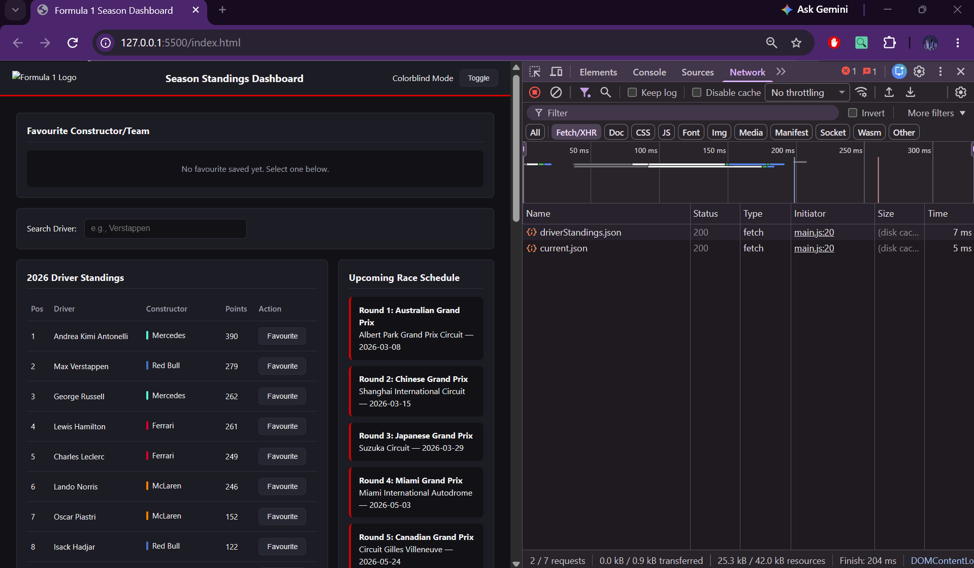

# COSC 219 — Project Proposal (M1)

**Names:** Liam McDonald  and  Mikyle Holt

**Repository (create it now, even if empty):** 
https://github.com/Philosoraptor02/F1Dashboard
---

## 1. What it does

Two sentences. Not three.

A client-side web application that fetches Formula 1 standings and the race schedules. Users can filter by race types(sprint, regular), race location(track) past races will show results, future races will show the scheduled date and time.
Users can save their favourite constructor(team) or driver to local storage for quick access.


## 2. Who would use it, and why

This is for F1 fans that want a clean, lightweight website to check the current F1 season standings without having to deal with bloated sports websites.


## 3. The API

**Name:Jolpica F1**

**Documentation link:https://api.jolpi.ca/ergast/f1/current/driverStandings.json**

**Does it need a key? No**  ☐ no key  ☐ publishable key, domain-restricted
☐ secret key — **if you ticked this, pick another API**

### Evidence it works from a browser

Paste the exact `fetch` you ran, and the first few lines of what came back.
Run it from a blank page with DevTools open, **before** you submit this.

```js
// the fetch you ran
fetch("https://api.jolpi.ca/ergast/f1/current/driverStandings.json")
```

```
// the first few lines of the response
Promise { <state>: "pending" }
  <state>: "fulfilled"
  <value>: Response { type: "cors", url: "https://api.jolpi.ca/ergast/f1/current/driverStandings.json", redirected: false, … }
    body: ReadableStream { locked: false }
    bodyUsed: false
    headers: Headers(4) { "cache-control" → "max-age=600", "content-type" → "application/json", expires → "Fri, 06 Nov 2026 18:43:43 GMT", … }
    ok: true
```

**Did it work without a CORS error?**  [x] yes  ☐ no — *then you cannot use it*

> This section is worth doing properly. An API that turns out to be unusable
> in Week 9 is a far worse problem than twenty minutes of checking now.


## 4. A sketch of the interface

Draw it. A photo of a hand drawing is completely fine — paste or attach it.

What does the user see first? What can they click?
successful fetch with page layout beside



## 5. The six requirements

For each, one line on how your app will meet it.

| Requirement | How yours does it |
|---|---|
| Fetches live data from a public API | Fetches current Formula 1 driver standings and race schedules from the public Jolpica F1 API |
| Lets the user change what they see |Users can search for drivers, constructors(teams) toggle colourblind mode, and filter races by type (sprint or regular), track, and past/upcoming status.|
| Persists something between visits |Saves the user's favourite driver and favourite constructor(team) to localStorage for quick access on returns.|
| Works on a phone and a laptop |Uses a responsive CSS Grid and Flexbox layout with content-driven breakpoints so standings and schedules stay readable from 320px to desktop sizes|
| Fully keyboard operable |Every search input, filter, and toggle will use semantic controls with logical Tab navigation and visible|
| Handles failure visibly | Checks response.ok on API requests and displays clear loading, empty-results, and on-page error states if the fetch fails.|


## 6. The hardest part

Which of the six do you expect to be hardest, and why?
The hardest part of this project will be getting larger data sets to be easily navigable with a keyboard. All the toggles might make tab key navigation confusing.


## 7. Who is doing what

| Partner | Taking on         |
|Liam     | search filter     |
|Liam     | driver standings  |
|Mikyle   | race scheduling   |
|Mikyle   | colourblind mode  |

> Split by **feature**, not by "you do the HTML and I'll do the JavaScript".
> Both of you speak at the demo, and either may be asked about any line.

